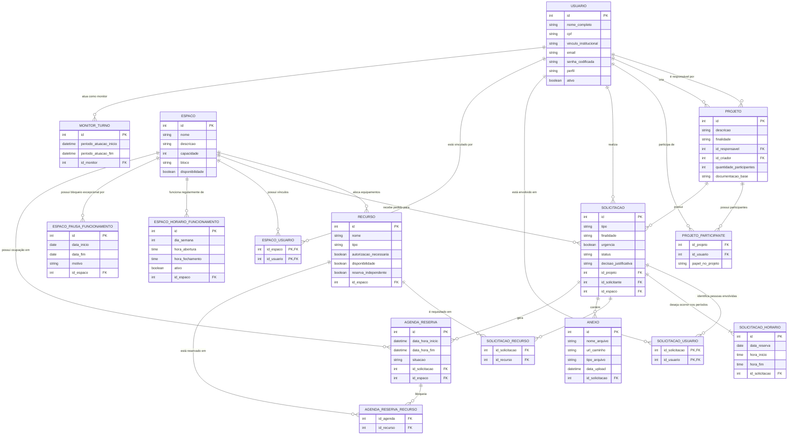

# 🗄️ Documentação do Banco de Dados - COLAB

Esta documentação descreve o **modelo relacional proposto** para o Sistema de Gestão e Agendamento do COLAB (IFAL), incluindo espaços, recursos, solicitações, reservas e monitoria.

> **Estado da implementação:** a aplicação implementa as tabelas de usuários, espaços (incluindo horários, pausas, vínculos e recursos), projetos (incluindo participantes) e solicitações (incluindo usuários envolvidos, horários e anexos). Reservas e turnos de monitoria permanecem sem implementação.

---

## 📊 Diagrama Entidade-Relacionamento (MER)

Abaixo está o modelo de dados proposto. Você pode visualizar este diagrama utilizando extensões de suporte ao Mermaid (ex: GitHub, VS Code) ou no [Mermaid Live Editor](https://mermaid.live).



---

## 📖 Dicionário de Dados e Justificativas

### 👤 1. USUARIO e Contexto Acadêmico

#### Tabela: `USUARIO`
*   **Justificativa:** Atende ao RF-01 (Autenticação e acesso por perfil) e RF-02 (Cadastro de solicitante). Responsável por gerenciar os atores do sistema.
*   **Atributos:**
    *   `nome_completo`, `cpf`, `vinculo_institucional` (matrícula): Dados obrigatórios para identificação formal do servidor/aluno no IFAL.
    *   `perfil`: Define autorizações do usuário (Coordenador, Servidor Solicitante, Monitor).

#### Tabela: `PROJETO`
*   **Justificativa:** Atende ao RF-04, registrando o contexto que motiva o uso do laboratório (pesquisa, extensão, disciplina).
*   **Atributos:**
    *   `descricao`, `finalidade`, `quantidade_participantes`: Informações descritivas do projeto.
    *   `id_responsavel`: Usuário responsável pelo projeto; pode ser diferente de quem o cadastrou.
    *   `id_criador`: Usuário autenticado que cadastrou o projeto. A aplicação usa esse dado para autorizar sua exclusão, junto com Administradores.
    *   `documentacao_base`: Link (ex: SIGAA, SUAP) comprovando a existência formal do projeto no instituto.
    *   O projeto não possui status próprio na implementação atual.

#### Tabela: `PROJETO_PARTICIPANTE`
*   **Justificativa:** Atende à Regra de Negócio RN-19, identificando as pessoas relevantes e autorizadas a permanecer no laboratório sob aquele projeto. É uma tabela associativa (N:N).

---

### 🏢 2. Infraestrutura Física

#### Tabela: `ESPACO`
*   **Justificativa:** Gestão dos ambientes físicos (salas/bancadas) alvos do agendamento (RN-01).
*   **Atributos:** `nome`, `descricao`, `capacidade`, `bloco`, `disponibilidade`.
*   **Implementação atual:** tabela `espaco`, com nome único, descrição de até 255 caracteres, capacidade inteira, bloco de até 50 caracteres e disponibilidade booleana.

#### Tabela associativa: `ESPACO_USUARIO`
*   **Implementação atual:** tabela `espaco_usuario`, que relaciona espaços a usuários (relação N:N). As colunas `id_espaco` e `id_usuario` formam a chave primária composta e são chaves estrangeiras para `espaco.id` e `usuario.id`, respectivamente.
*   **Regra da aplicação:** os vínculos são permitidos somente para usuários com perfil Coordenador ou Monitor. Esta tabela associativa não está representada no modelo conceitual anterior e foi incluída para refletir a implementação atual.

#### Tabelas: `ESPACO_HORARIO_FUNCIONAMENTO` e `ESPACO_PAUSA_FUNCIONAMENTO`
*   **Justificativa:** Atendem diretamente às regras RN-11 e RN-12. O laboratório funciona em horários padronizados, mas requer fechamentos sazonais.
*   **Atributos:** 
    *   `dia_semana`, `hora_abertura`, `hora_fechamento`: (ex: seg-sex, 8h às 18h).
    *   `data_inicio`, `data_fim`, `motivo`: Registra feriados, férias e dedetizações que impedem agendamentos.

#### Tabela: `RECURSO`
*   **Justificativa:** Ferramentas, equipamentos e máquinas físicas inseridas nos espaços.
*   **Atributos:** 
    *   `nome`, `tipo`: Identificação e classificação do recurso.
    *   `autorizacao_necessaria`: Sinaliza equipamentos de risco (ex: serra circular) que barram aprovações automáticas (RN-13).
    *   `disponibilidade`: Indica se o recurso está disponível para uso.
    *   `reserva_independente`: Indica se o recurso pode ser reservado sem reservar o espaço (padrão `false`).
    *   `id_espaco`: Onde fisicamente aquele recurso se encontra.
*   **Implementação atual:** tabela `recurso`, com nome e tipo de até 100 caracteres, flags booleanas e chave estrangeira obrigatória para `espaco.id`. A exclusão da API é lógica: define `disponibilidade=false`.

---

### 📅 3. Core: Fluxo de Solicitação e Agendamento

#### Tabela: `SOLICITACAO`
*   **Justificativa:** O "pedido" de uso feito pelo servidor (RF-03 e FB-01).
*   **Atributos:**
    *   `urgencia`: Requisito RF-07, informa ao gestor prioridade de análise.
    *   `status`: Situação do pedido (Pendente ou Cancelada na implementação atual; estados de análise permanecem futuros).
    *   `decisao_justificativa`: O coordenador *precisa* registrar o motivo da sua decisão (RF-09).

#### Tabela: `SOLICITACAO_HORARIO`
*   **Implementação atual:** cada horário solicitado é salvo em uma linha da tabela `solicitacao_horario`, ligada à solicitação por `id_solicitacao`.
*   **Atributos:** `data_reserva` (DATE), `hora_inicio` e `hora_fim` (TIME). A API exige ao menos um horário, data/início futuros e hora final posterior à inicial.

#### Tabela: `SOLICITACAO_RECURSO`
*   **Justificativa:** Uma solicitação a um espaço pode exigir o uso de N máquinas/equipamentos específicos.

#### Tabela: `ANEXO`
*   **Implementação atual:** a tabela `anexo` guarda metadados e o caminho interno do objeto no Supabase Storage; o bucket é privado, portanto `url_caminho` não é uma URL pública.
*   **Atributos:** `nome_arquivo`, `url_caminho`, `tipo_arquivo`, `data_upload` e `id_solicitacao`.
*   **Regras atuais:** aceita PDF e DOCX de até 150 KiB por arquivo. O download é feito por URL assinada temporária.

### Migração no Supabase

`Base.metadata.create_all` cria tabelas ausentes, mas não altera tabelas já existentes. Para atualizar um banco Supabase já utilizado, execute uma migração pelo SQL Editor do Supabase:

```sql
CREATE TABLE IF NOT EXISTS public.solicitacao_horario (
    id integer GENERATED BY DEFAULT AS IDENTITY PRIMARY KEY,
    data_reserva date NOT NULL,
    hora_inicio time NOT NULL,
    hora_fim time NOT NULL,
    id_solicitacao integer NOT NULL
        REFERENCES public.solicitacao(id) ON DELETE CASCADE
);

CREATE INDEX IF NOT EXISTS ix_solicitacao_horario_id_solicitacao
    ON public.solicitacao_horario (id_solicitacao);

CREATE TABLE IF NOT EXISTS public.anexo (
    id integer GENERATED BY DEFAULT AS IDENTITY PRIMARY KEY,
    nome_arquivo varchar(255) NOT NULL,
    url_caminho varchar(500) NOT NULL,
    tipo_arquivo varchar(100) NOT NULL,
    data_upload timestamptz NOT NULL,
    id_solicitacao integer NOT NULL
        REFERENCES public.solicitacao(id) ON DELETE CASCADE
);

CREATE INDEX IF NOT EXISTS ix_anexo_id_solicitacao
    ON public.anexo (id_solicitacao);
```

Confirme que `public.solicitacao.id` usa o tipo `integer` antes de executar a migração. Além das tabelas, crie o bucket privado e configure as variáveis de ambiente descritas em [casos de uso de solicitações](./casos_de_uso/agendamento.md#configuração-do-supabase-storage).

---

### 📆 4. Efetivação: Agenda e Rastreabilidade

#### Tabelas: `AGENDA_RESERVA` e `AGENDA_RESERVA_RECURSO`
*   **Justificativa:** Representa o tempo bloqueado oficialmente na agenda após uma `SOLICITACAO` ter sido aprovada (RF-10 e RF-12).
*   **Diferencial:** Ao isolar os recursos aprovados na tabela `AGENDA_RESERVA_RECURSO`, o sistema consegue checar individualmente conflitos de ferramentas. (Ex: A sala pode estar disponível, mas o osciloscópio solicitado já está em uso).

#### Tabela: `MONITOR_TURNO`
*   **Justificativa:** Atende ao RF-14 e RF-15, viabilizando histórico, segurança e rastreabilidade da operação do laboratório.
*   **Atributos:** `periodo_atuacao_inicio`, `periodo_atuacao_fim` e vínculo com o monitor responsável pelo turno.