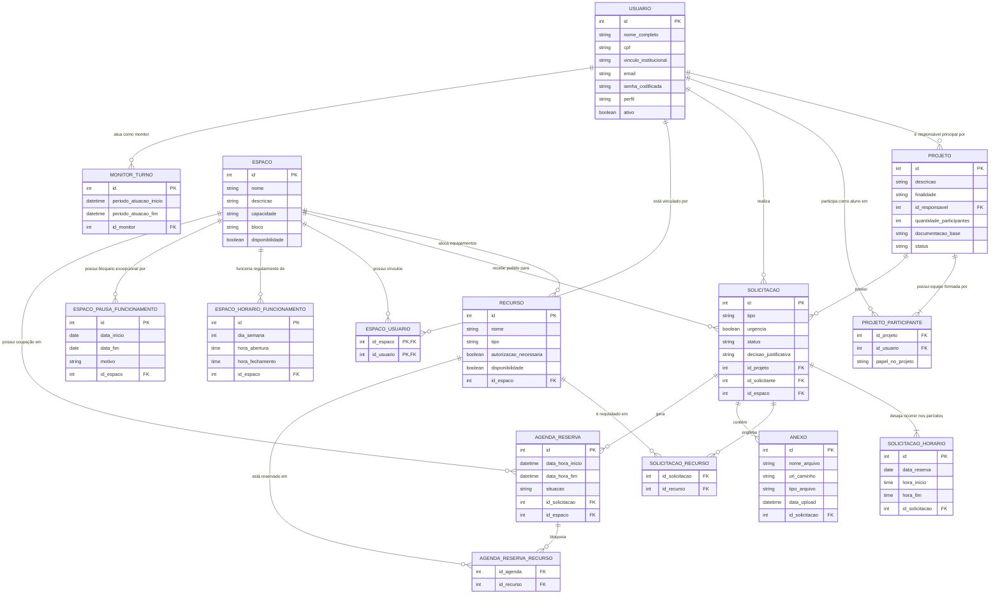

# 🗄️ Documentação do Banco de Dados - COLAB

Esta documentação descreve o **modelo relacional proposto** para o Sistema de Gestão e Agendamento do COLAB (IFAL), incluindo espaços, recursos, solicitações, reservas e monitoria.

> **Estado da implementação:** o diagrama representa o modelo-alvo do sistema. A aplicação cria atualmente as tabelas `usuario`, `espaco`, `espaco_usuario`, `projeto` e `projeto_participante` na inicialização; as demais entidades ainda não estão implementadas no código.

---

## 📊 Diagrama Entidade-Relacionamento (MER)

Abaixo está o modelo de dados proposto. Você pode visualizar este diagrama utilizando extensões de suporte ao Mermaid (ex: GitHub, VS Code) ou no [Mermaid Live Editor](https://mermaid.live).

---

## 📖 Dicionário de Dados e Justificativas

### 👤 1. USUARIO e Contexto Acadêmico

#### Tabela: `USUARIO`
*   **Justificativa:** Atende ao RF-01 (Autenticação e acesso por perfil) e RF-02 (Cadastro de solicitante). Responsável por gerenciar os atores do sistema.
*   **Atributos:**
    *   `nome_completo`, `cpf`, `vinculo_institucional` (matrícula): Dados obrigatórios para identificação formal do servidor/aluno no IFAL.
    *   `perfil`: Define autorizações do usuário (Coordenador, Servidor Solicitante, Monitor).

#### Tabela: `PROJETO`
*   **Justificativa:** Atende ao RF-04, registrando o contexto que motiva o uso do laboratório (pesquisa, extensão, disciplina).
*   **Atributos:**
    *   `descricao`, `finalidade`, `quantidade_participantes`: Informações que balizam a prioridade de análise pela coordenação.
    *   `documentacao_base`: Link (ex: SIGAA, SUAP) comprovando a existência formal do projeto no instituto.
    *   `status`: Avaliação administrativa do projeto (`Pendente`, `Aceito` ou `Recusado`), distinta da decisão sobre uma solicitação de uso.

#### Tabela: `PROJETO_PARTICIPANTE`
*   **Justificativa:** Atende à Regra de Negócio RN-19, identificando as pessoas relevantes e autorizadas a permanecer no laboratório sob aquele projeto. É uma tabela associativa (N:N).

---

### 🏢 2. Infraestrutura Física

#### Tabela: `ESPACO`
*   **Justificativa:** Gestão dos ambientes físicos (salas/bancadas) alvos do agendamento (RN-01).
*   **Atributos:** `nome`, `descricao`, `capacidade`, `bloco`, `disponibilidade`.
*   **Implementação atual:** tabela `espaco`, com nome único, descrição de até 255 caracteres, capacidade e bloco de até 50 caracteres e disponibilidade booleana.

#### Tabela associativa: `ESPACO_USUARIO`
*   **Implementação atual:** tabela `espaco_usuario`, que relaciona espaços a usuários (relação N:N). As colunas `id_espaco` e `id_usuario` formam a chave primária composta e são chaves estrangeiras para `espaco.id` e `usuario.id`, respectivamente.
*   **Regra da aplicação:** os vínculos são permitidos somente para usuários com perfil Coordenador ou Monitor. Esta tabela associativa não está representada no modelo conceitual anterior e foi incluída para refletir a implementação atual.

#### Tabelas: `ESPACO_HORARIO_FUNCIONAMENTO` e `ESPACO_PAUSA_FUNCIONAMENTO`
*   **Justificativa:** Atendem diretamente às regras RN-11 e RN-12. O laboratório funciona em horários padronizados, mas requer fechamentos sazonais.
*   **Atributos:** 
    *   `dia_semana`, `hora_abertura`, `hora_fechamento`: (ex: seg-sex, 8h às 18h).
    *   `data_inicio`, `data_fim`, `motivo`: Registra feriados, férias e dedetizações que impedem agendamentos.

#### Tabela: `RECURSO`
*   **Justificativa:** Ferramentas, equipamentos e máquinas físicas inseridas nos espaços.
*   **Atributos:** 
    *   `autorizacao_necessaria`: Sinaliza equipamentos de risco (ex: serra circular) que barram aprovações automáticas (RN-13).
    *   `id_espaco`: Onde fisicamente aquele recurso se encontra.

---

### 📅 3. Core: Fluxo de Solicitação e Agendamento

#### Tabela: `SOLICITACAO`
*   **Justificativa:** O "pedido" de uso feito pelo servidor (RF-03 e FB-01).
*   **Atributos:**
    *   `urgencia`: Requisito RF-07, informa ao gestor prioridade de análise.
    *   `status`: Situação do pedido (Pendente, Aprovado, Rejeitado, Replanejado).
    *   `decisao_justificativa`: O coordenador *precisa* registrar o motivo da sua decisão (RF-09).

#### Tabela: `SOLICITACAO_HORARIO`
*   **Justificativa:** Substitui colunas rígidas de "data-hora" na tabela de solicitação principal, permitindo **recorrência** (ex: toda segunda-feira do mês) e facilitando o replanejamento pontual de dias pelo coordenador sem cancelar toda a solicitação (RF-11).
*   **Atributos:** `data_reserva` (DATE), `hora_inicio` e `hora_fim` (TIME).

#### Tabela: `SOLICITACAO_RECURSO`
*   **Justificativa:** Uma solicitação a um espaço pode exigir o uso de N máquinas/equipamentos específicos.

#### Tabela: `ANEXO`
*   **Justificativa:** Atende ao RF-05. Alguns equipamentos (como impressoras 3D ou máquinas CNC) e serviços exigem análise técnica de arquivos (modelos STL, PDFs) antes da aprovação da solicitação (FB-02).
*   **Atributos:** `nome_arquivo`, `url_caminho`, `tipo_arquivo`.

---

### 📆 4. Efetivação: Agenda e Rastreabilidade

#### Tabelas: `AGENDA_RESERVA` e `AGENDA_RESERVA_RECURSO`
*   **Justificativa:** Representa o tempo bloqueado oficialmente na agenda após uma `SOLICITACAO` ter sido aprovada (RF-10 e RF-12).
*   **Diferencial:** Ao isolar os recursos aprovados na tabela `AGENDA_RESERVA_RECURSO`, o sistema consegue checar individualmente conflitos de ferramentas. (Ex: A sala pode estar disponível, mas o osciloscópio solicitado já está em uso).

#### Tabela: `MONITOR_TURNO`
*   **Justificativa:** Atende ao RF-14 e RF-15, viabilizando histórico, segurança e rastreabilidade da operação do laboratório.
*   **Atributos:** `periodo_atuacao_inicio`, `periodo_atuacao_fim` e vínculo com o monitor responsável pelo turno.